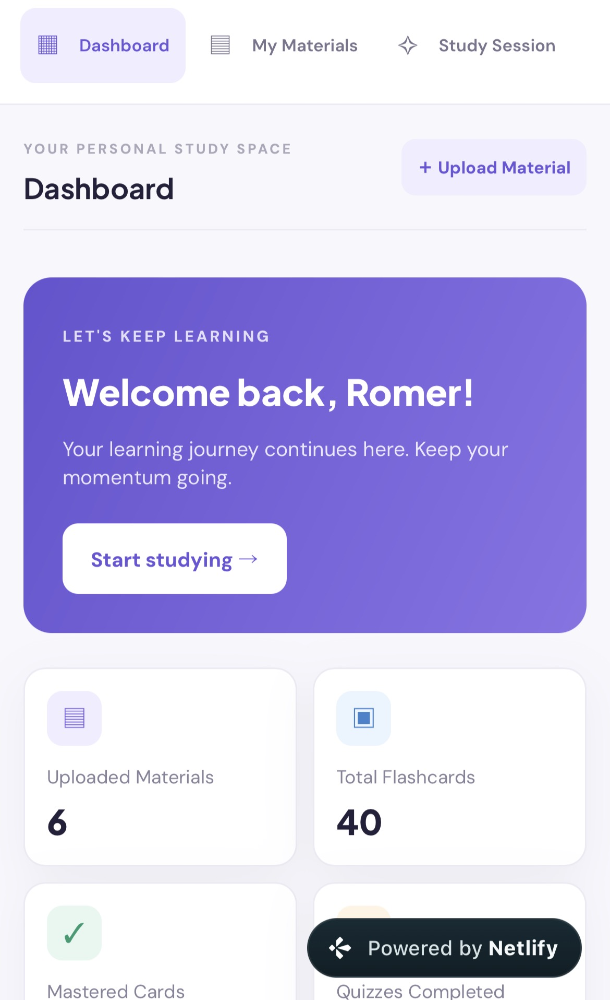
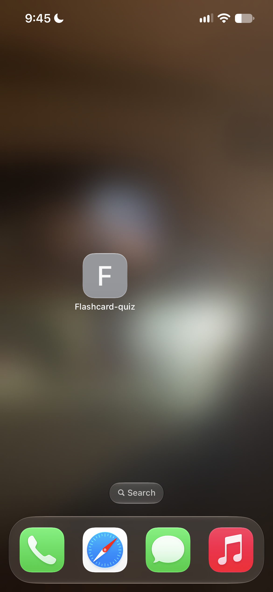

# flashcard-quiz

Recall - Flashcard & Quiz App
A simple and smart web app that helps students study faster by automatically generating flashcards and quizzes from uploaded learning materials.

LIVE DEMO:
https://statuesque-mermaid-6c69fa.netlify.app

VIDEO DEMONSTRATION:https://drive.google.com/file/d/1mM_KcCrMsmOov3N8KVAXSvPI_O-0LLI6/view?usp=drivesdk&usp=embed_facebook

FEATURES:

Home / Dashboard
Shows total Uploaded Materials, Total Flashcards, Mastered Cards, and Quizzes Completed
Displays Welcome Message and Study Progress
Quick Start Study button

Create Account / Login
Enter Full Name, Email, and Password
Create account and auto-redirect to Dashboard
Secure login system

MY MATERIALS (Upload System):
Upload files: PDF, PPTX, DOCX, TXT (Max 20MB per file)
Supports multiple uploads (ex. 6 modules in the demo)
Examples: Hardware Components and Platform Performance, Fundamentals of Computer Architecture, Chapter 3, 4, 5, 5.4 Cross-Platform
Auto-extract text and show character count (ex. 18k chars)
View all uploaded materials in one place

STUDY SESSION
CHOOSE STUDY MODE:
    - Flashcards - Review terms and concepts
    - Quiz - Test understanding
    - Both - Flashcards first, then Quiz
CHOOSE SOURCE:
    - All uploaded modules
    - Choose specific module/s (ex. Chapter 5 only)

FLASHCARDS FEATURES:
Click to Flip - Question on front, Answer on back
Navigation: Previous / Flip Card / Next
Action buttons: Review Again / I Know This
Auto-generates up to 40 flashcards per session
Tracks mastered cards

QUIZ FEATURE:
Auto-generates up questions from uploaded materials
Multiple choice format (A, B, C, D)
Instant feedback: Green for correct, Red for wrong
Shows correct answer after each question
Live Score counter on top

PROGRESS TRACKING:
After study, returns to Dashboard
Updated stats: Uploaded Materials , Total Flashcards.
Tracks quizzes completed and mastered cards

HOW TO INSTALL AND RUN:
  https://github.com/ROMERLAURO/flashcard-quiz
Open the project folder
Open  in your browser or run with Live Server
Or add to home screen 

TECHNOLOGIES USED:
HTML, CSS, JavaScript
AI for text extraction and Q&A generation
Netlify for deployment

SCREENSHOTS:

CREATED BY:LAURO,ROMER N.

BSINTE 2A